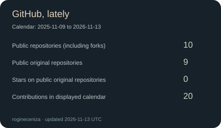
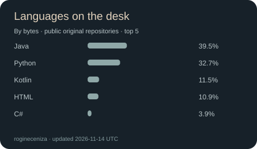
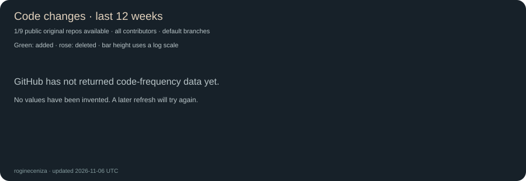

<!-- A cozy, gloomy corner of GitHub. 🌧️ -->

  

  <h1>hey, i'm Rogine</h1>
  <h3>learning full-stack web development, one application at a time.</h3>
  
<i>I love gloomy coding days: rain and thunder in the background, coffee beside me, and something new to learn.</i>

  
  

---

## `whoami`

I'm learning full-stack development by building actual applications and figuring things out as I go. I like seeing an idea turn into something I can click, use, and keep improving.

AI is part of how I code and learn. I use it to explore approaches, ask follow-up questions, and help me understand what I'm building. One explanation usually leads to another question—and occasionally a completely different technology I now want to try.

- **Right now:** connecting the frontend, backend, and database pieces.
- **Getting better at:** writing code I can explain, working with APIs, and organizing applications.
- **Usually curious about:** AI tools, new development concepts, and how other people solve the same problem.
- **Current challenge:** so much to learn, so few hours in a rainy afternoon.

> Build something. Understand it a little better. Come back and improve it.

## `tech_stack.exe`

Tools I'm learning, practicing with, or returning to as I build. This is my workbench, not a list of things I've mastered.

### Frontend

### Backend &amp; data

### Everyday tools &amp; AI

AI-assisted coding, explanations, and a lot of follow-up questions are part of the workflow too.

☕ Coffee: usually ready before the development server. Sometimes forgotten until after.

## `./projects`

A few projects I've been working on. Different ideas, plenty of lessons, and room for the next one.

<table>
  <tr>
    <td width="50%" valign="top">
      <h3>🍼 Baby Cry Recognition</h3>
      
My project exploring how to recognize and classify baby cries.

      
<a href="https://github.com/rogineceniza/cry-code">View repository</a>

    </td>
    <td width="50%" valign="top">
      <h3>🎙️ Baby Cry Recorder Mobile App</h3>
      
A mobile application for recording baby cries, connected to my baby-cry project work.

      
<a href="https://github.com/rogineceniza/Android-App-Baby-Cry">View repository</a>

    </td>
  </tr>
  <tr>
    <td width="50%" valign="top">
      <h3>🚗 Car Rental</h3>
      
My car rental application project. More details belong here as I share the work.

      <!-- Add a verified project URL here when available. -->
    </td>
    <td width="50%" valign="top">
      <h3>🪴 Progress Companion</h3>
      
My progress-tracking companion application. A place for the small steps along the way.

      <!-- Add a verified project URL here when available. -->
    </td>
  </tr>
</table>

<i>Next project: there's always another idea waiting in an open tab.</i>

<!-- Add future project rows to the table above. -->

## `git status`

  
  

Real account data, refreshed by the profile workflow. Language share measures repository code, not skill level or time spent coding.

### A little city under cloudy skies

One day per building. Taller buildings mean more contributions; the date range is shown in the image.

### What changed in the code

Repository code changes include all contributors on the default branches, not just my commits. This is activity, not a productivity score. Unavailable repositories are excluded and coverage is shown.

### `coding_log --last-7-days`

<!--START_SECTION:waka-->
*The coding log is optional. For now, the coffee log is more consistent.*
<!--END_SECTION:waka-->

  
About the coding log

WakaTime can fill this section with editor activity once connected. Setup and data coverage notes are in [SETUP.md](./SETUP.md).

## `side_quests`

<i>So much to learn. One coffee at a time.</i>

<table>
  <tr>
    <td width="50%" valign="top">
      <h3>Between learning sessions</h3>
      
🪴 Remembering to water the plants

      
☕ Drinking the coffee while it's still coffee-temperature

      
🌧️ Listening to rain and thunder while I code

    </td>
    <td width="50%" valign="top">
      <h3>Tabs I didn't plan to open</h3>
      
🤖 Exploring another AI tool

      
📚 Learning the concept behind the explanation

      
🕰️ Wondering how one question became an entire evening

    </td>
  </tr>
</table>

  
  
me after asking AI one simple question and discovering twelve more things i need to learn

## `./contact`

I'm usually learning by doing, experimenting with an idea, or exploring how AI can help me understand and build an application. If you're figuring things out too, feel free to say hi—I'm happy to compare notes.

---

  
<i>rain outside, coffee beside me, another idea on my mind.</i>

  
i probably came here to finish one thing and ended up learning three others. thanks for dropping by my little corner of GitHub. 🌧️☕🪴

