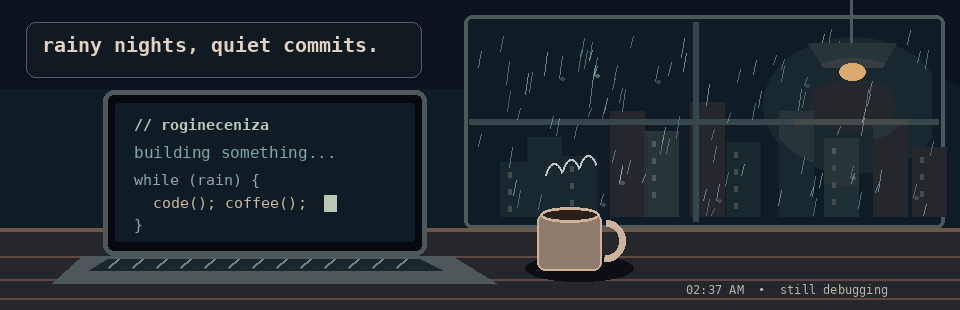
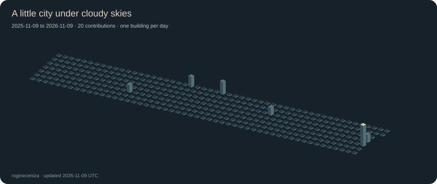
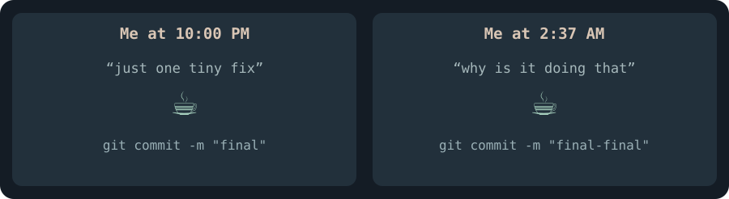

<!-- A cozy, gloomy corner of GitHub. 🌧️ -->
<div align="center">
  

  <h1>hey, i'm Rogine 👋</h1>
  <h3>Computer Engineering student · software + hardware tinkerer</h3>
  <p><i>Somewhere between writing code, wiring circuits, and waiting for the rain to stop.</i></p>

  <a href="https://github.com/rogineceniza"></a>
  
</div>

---

## `whoami`

```yaml
name: Rogine
location: Philippines
education: BS Computer Engineering

currently:
  exploring:
    - Web development and interactive interfaces
    - Embedded systems and microcontrollers
    - Programming, hardware, and software integration
  tinkering_with:
    - Arduino and ESP8266 projects
    - C, Python, JavaScript, and more
    - Ideas that started as "this should be easy"

interests:
  - Useful little projects
  - Code that talks to hardware
  - Learning by building (and debugging)
  - Rainy evenings and cozy desk setups

status: "probably debugging something"
```

> **Current objective:** build things that work in the real world, not just on the screen.

<br />

## `tech_stack.exe`

### Programming &amp; Web

<p>
  
</p>

### Electronics &amp; Development Tools

<p>
  
</p>

```text
Debugging       █████████░   almost a second major
Coffee          ████████░░   helpful in theory
Open tabs       ██████████   no comment
Sleep           ███░░░░░░░   needs optimization
```

<br />

## `./projects`

A few things I’m building and exploring.

<table>
  <tr>
    <td width="50%" valign="top">
      <h3>🔐 Fingerprint Booth Security</h3>
      <p>A Computer Engineering research concept involving one-time fingerprint access, compartment status, and SMS alerts.</p>
      <p><b>Tech:</b> <code>Arduino</code> <code>Fingerprint Sensor</code> <code>GSM</code></p>
      <p><i>Research / prototype work</i></p>
    </td>
    <td width="50%" valign="top">
      <h3>🌐 Web Experiments</h3>
      <p>Interfaces, small interactive features, and browser-side JavaScript experiments.</p>
      <p><b>Tech:</b> <code>HTML</code> <code>CSS</code> <code>JavaScript</code></p>
      <a href="https://github.com/rogineceniza?tab=repositories">Browse repositories</a>
    </td>
  </tr>
  <tr>
    <td width="50%" valign="top">
      <h3>🔌 Microcontroller Builds</h3>
      <p>Experiments with sensors, actuators, embedded logic, and Wi-Fi controls.</p>
      <p><b>Tech:</b> <code>Arduino</code> <code>ESP8266</code> <code>C/C++</code></p>
      <a href="https://github.com/rogineceniza?tab=repositories">Explore my work</a>
    </td>
    <td width="50%" valign="top">
      <h3>☁️ Still Brewing...</h3>
      <p>A few ideas, a few unfinished branches, and at least one mysterious bug.</p>
      <pre><code>while (curious) {
  learn();
  build();
  debug();
}</code></pre>
    </td>
  </tr>
</table>

<br />

## `git status`

<p align="center">
  <a href="https://github.com/rogineceniza?tab=repositories">Browse my repositories</a> ·
  <a href="https://github.com/rogineceniza/rogineceniza/commits/main/">Profile commit history</a>
</p>

<p align="center"><sub>The stats cards are taking a rain check. For now, my repositories have the latest code.</sub></p>

<!-- Stats-card endpoints returned HTTP 503 during review. Restore when available.
<div align="center">
  
  
</div>
Repository language stats reflect code in repositories, rather than time spent coding.
-->

### A little city made of commits

<div align="center">
  <p><i>Still under construction — the contribution city will appear here once its generator is set up.</i></p>
  <!-- Restore the image below only after the generator and its output exist:
  
  -->
</div>

### `coding_log --last-7-days`

<!-- Keep these markers for a future WakaTime workflow. -->
<!--START_SECTION:waka-->
<!--END_SECTION:waka-->

<sub>Coding log coming soon, once my editor and the WakaTime workflow are connected.</sub>

<br />

## `side_quests`

<p align="center"><i>Because apparently Computer Engineering wasn't enough.</i></p>

<table>
  <tr>
    <td width="50%" valign="top">
      <h3>Currently attempting</h3>
      <p>🪴 Keeping plants alive (the real endurance test)</p>
      <p>☕ Drinking coffee before it gets cold</p>
      <p>🧩 Understanding code I wrote yesterday</p>
    </td>
    <td width="50%" valign="top">
      <h3>Recurring quests</h3>
      <p>🌧️ Finding the perfect rainy coding playlist</p>
      <p>🐛 Fixing one bug without creating three</p>
      <p>💻 Closing unnecessary browser tabs</p>
    </td>
  </tr>
</table>

<div align="center">
  
  <br />
  
  <p><sub>me when the code works and i don't know why</sub></p>
</div>

<br />

## `./contact`

If you enjoy building things, breaking them, and figuring out how they work, we'll probably get along.

<p>
  <a href="https://github.com/rogineceniza"></a>
</p>

---

<div align="center">
  <p><i>It's raining outside. The code can wait five minutes.</i></p>
  <sub>Thanks for stopping by my tiny corner of the internet ☕ 🌧️</sub>
</div>
